<div align="center">




### 🔥 whoami

</div>

```js
const Dendzy = {
  vibe     : 'разработчик 🔥',
  focus    : ['сайты', 'приложения', 'боты'],
  stack    : ['HTML', 'CSS', 'JS', 'Kotlin', 'Python'],
  motto    : 'если приложения нет — я его делаю',
};
```

<div align="center">


### 🛠️ стек


### 📂 проекты

_Скоро здесь появятся проекты._

<!-- когда будет готов репозиторий, раскомментируй и подставь его имя вместо REPO
<a href="https://github.com/Dendzyhype/REPO"></a>
-->


### 📊 статистика


</div>
